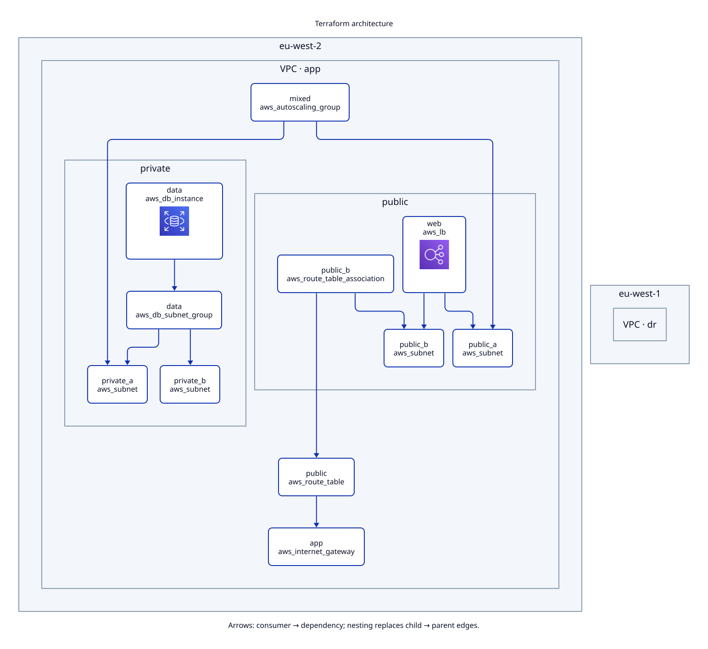

# edgemap



Read Terraform/OpenTofu configuration and produce a grouped architecture diagram
without cloud credentials, `terraform init`, or executing Terraform.

## Install from this checkout

Requires Go 1.27.3. No release has been published yet.

```sh
go install ./cmd/edgemap
edgemap render ./testdata/multi-az
```

The default writes `diagram.svg` and editable `diagram.d2`. SVG icons are bundled
into data URIs; a generated SVG can be viewed offline. The D2 file refers to icons
by their public `https://icons.terrastruct.com` URLs, never by local cache paths.

## Commands

```sh
edgemap render [dir]
edgemap inspect [dir]
edgemap version
```

| Flag | Default | Purpose |
| --- | --- | --- |
| `--plan` | unset | Local JSON plan for counts and change colours |
| `--out` | `diagram.svg` | Output path; extension must match format |
| `--format` | `svg` | `svg` (plus D2 sidecar) or `d2` only |
| `--layout` | `elk` | `elk` or `dagre` |
| `--no-icons` | false | Completely disable icon fetching |
| `--show-iam` | false | Draw IAM resources instead of badges |
| `--show-data` | false | Draw data sources |
| `--show-sg` | false | Draw security groups and rules instead of badges |
| `--title` | Terraform architecture | Diagram heading |

## How it decides what to draw

AWS containment uses resource attributes: region → VPC → public/private/unknown
subnet tier. Provider aliases supply regions. Nonliteral regions remain labelled
as expressions; accounts are never inferred. A default route to an internet
gateway, public-IP assignment, or a Name tag can identify a public subnet.
Name tags identify private subnets; no evidence means `subnets`.

ALBs, RDS, ASGs and Lambda functions referring to several subnets sit at their
shared tier, or their VPC when tiers differ. Unknown AWS types go in `Other`;
IAM, S3, Route53 and CloudFront go in `Global`.

Arrows point **from the consumer to its dependency**. Repeated references are
bundled and counted. Nesting replaces child-to-parent edges. Provider blocks,
variables, locals, outputs and Terraform backend configuration are never drawn.
IAM and security groups are hidden by default and summarized as badges on their
consumers. Data sources are hidden, except that a `data "aws_vpc"` still draws
as a VPC container while it holds visible resources. Use the `--show-*` flags to
reveal them.

Local modules and already-installed modules are expanded. Other modules remain
collapsed. The standard AWS VPC module has synthetic public/private tiers so
its subnet outputs can place callers without downloading the module.

## Plan overlays

Use `--plan /path/to/plan.json` with JSON from `terraform show -json`. Only
resource addresses, types and action lists are retained; before/after values
are skipped. Plans stay local and must never be committed or uploaded.

Instance keys collapse onto their configuration node. Badges show the count
after the plan and per-action totals; replacements count as both create and
destroy. Red (destroy) takes priority over amber (change), then green (create).
Resources absent from configuration appear under `Plan-only · placement unknown`.
Counts for unexpanded modules describe aggregate plan resources. Forget actions
use grey and explicitly say that infrastructure remains.

## Limits and network behaviour

- Static approximation, not a Terraform evaluator or a deployed-resource inventory.
- Conditions, variables, functions and `for_each` are not evaluated. Literal
  locals can be resolved; unresolved multiplicity is `×?`.
- Resource literals such as a hard-coded subnet ID cannot establish references.
- Provider-specific semantic grouping is AWS only; the catalog is deliberately small.
- Broken files produce warnings and partial results. `inspect` lists the warnings.
- Symlinked and special-file inputs are skipped. Individual input files are limited
  to 16 MiB, module nesting to 32 levels, expanded module calls to 10,000 and parsed
  nodes to 10,000; exceeding the load or node limit stops with an error.
- Default SVG renders fetch a small fixed set of AWS icons from
  `https://icons.terrastruct.com` and cache them under the user cache directory.
  Fetch failures use plain shapes with a warning; after the first network failure
  no further icons are requested. `--format d2` and `--no-icons` make no requests.
- No telemetry, cloud API calls, module downloads, or Terraform subprocesses.

## Contributing

Use pull requests and Conventional Commits. Run:

```sh
go test ./...
go test ./internal/parse -run='^$' -fuzz=FuzzParse -fuzztime=30s
golangci-lint run
golangci-lint fmt --diff
```

Inspect changes before updating goldens with `UPDATE_GOLDEN=1 go test ./...`.
Never commit Terraform plans, state, credentials or customer configuration.

Apache-2.0. Dependencies retain their own licences; third-party notices accompany
release archives. AWS icons are fetched separately and are not vendored here.


## Release and Action setup

Release workflows are prepared; publication and hosted smoke tests are pending.
Once v0.1.0 is published, the intended Homebrew command is:

```sh
brew install Infraedgecloud-tools/tap/edgemap
```

The composite Action downloads an exact release and checks the archive against that
release's `checksums.txt`. This detects a corrupted download, not a tampered release.
After publishing, use it following `actions/checkout`, with `contents: read`:

```yaml
- uses: Infraedgecloud-tools/edgemap@v0.1.0
  with:
    directory: ./infrastructure
    version: v0.1.0
    no-icons: 'true'
```

Pin the Action to the release commit SHA in production workflows. It uploads only
the SVG and adds a download link to the job summary; it does not post PR comments
or upload plans. GitHub artifact links are not inline SVG previews.

See [architecture](docs/architecture.md), [source adapters](docs/adding-a-source.md)
and [release gates](docs/releasing.md).

Built and maintained by [InfraEdge](https://infraedge.org).
